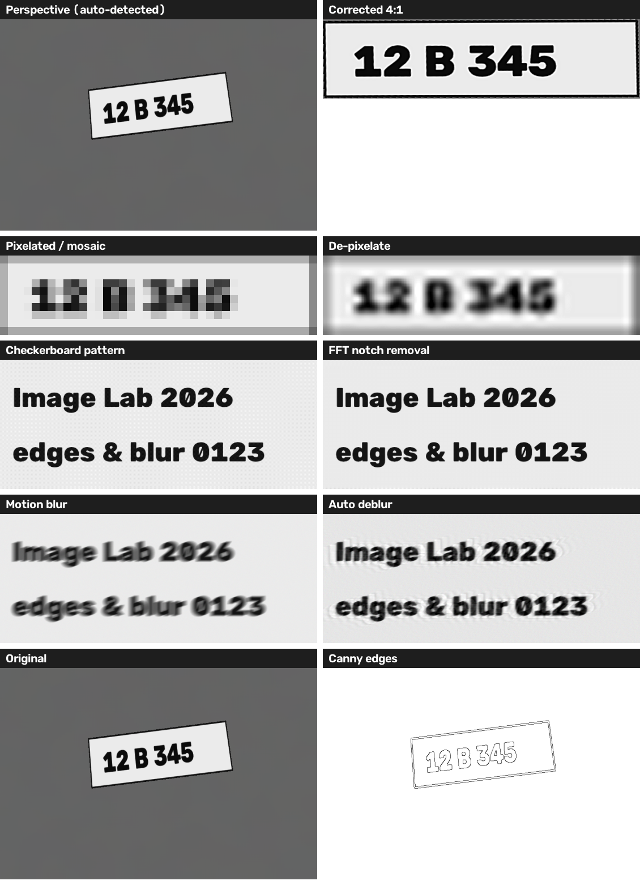
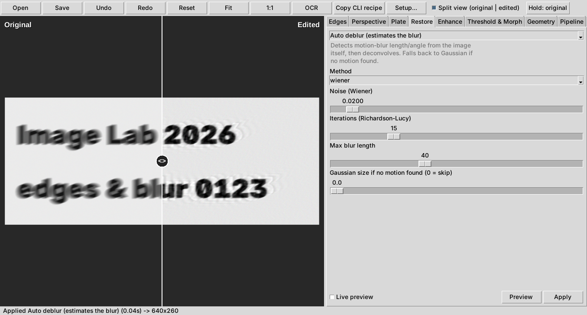
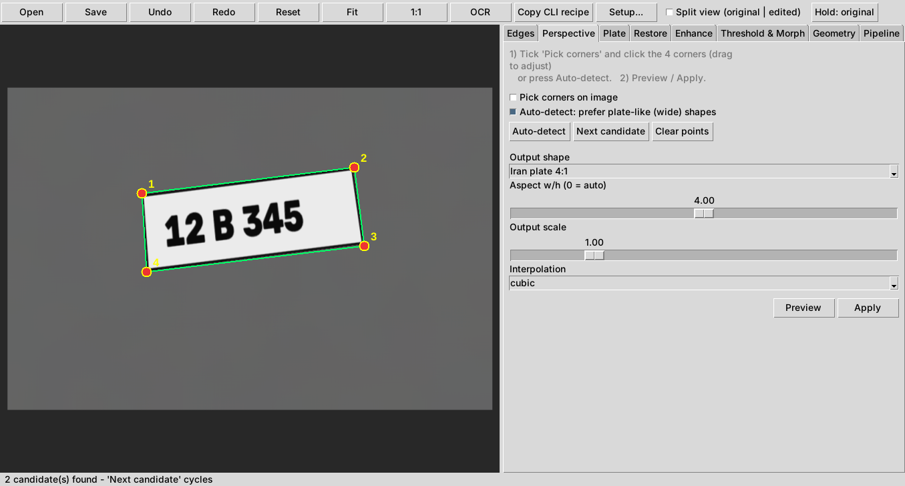
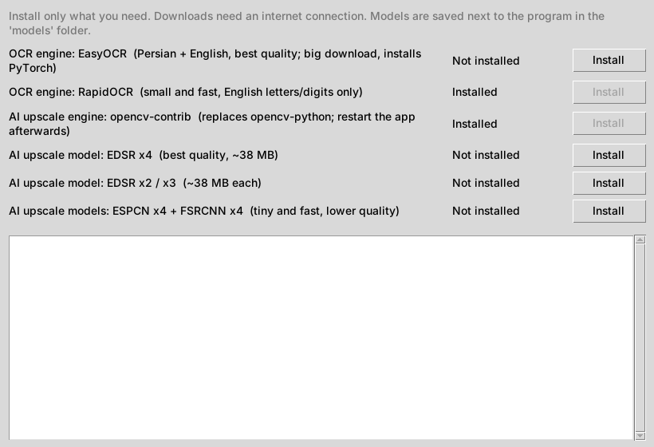

# imglab

A single-file Python toolkit for **finding edges, straightening perspective (license plates, documents, signs) and restoring poor-quality images**. It has a desktop GUI with a live **original | edited split view**, and a command-line mode for scripts and batch jobs.



<sub>Synthetic test images, generated with the program itself. Real photos with real damage will not recover as cleanly — see [Limitations](#limitations).</sub>

## Features

| Area | What you get |
|---|---|
| **Edge detection** | Canny (auto thresholds), Sobel / Scharr / Prewitt / Roberts, Laplacian of Gaussian, Difference of Gaussians, morphological gradient, contour finder. Output as edges only, overlay on the photo, or edges with original colours. |
| **Perspective correction** | Click 4 corners (draggable) or **auto-detect** the quadrilateral, with a "plate-like" filter and a candidate cycler. Output presets: Iran/EU/US plate, A4, ID card, square, or any custom aspect ratio. |
| **Restoration** | De-pixelate / de-mosaic (block size detected automatically), checkerboard / halftone / moiré removal (FFT notch filter), **auto deblur** (estimates motion-blur length and angle), Wiener and Richardson–Lucy deconvolution, NL-means / bilateral / median denoise, upscale (smart multi-step, Lanczos, cubic) and optional neural **AI upscale** (EDSR, ESPCN, FSRCNN, LapSRN). |
| **Enhance** | Unsharp mask, CLAHE, auto levels (optionally per channel to fix colour casts), gamma, brightness / contrast, grayscale, invert. |
| **Plate mode** | One click: detect → straighten → denoise → deblur → normalise height → local contrast → sharpen, plus an optional **OCR** button. |
| **Geometry / threshold** | Free-angle rotate, flip, **auto deskew**, adaptive / Otsu binarisation, morphology. |
| **Workflow** | Split view, hold-to-compare, undo / redo, pipeline editor (reorder, remove, rebuild from the original), JSON presets, **batch folder processing**, "copy CLI recipe". |
| **Setup from inside the app** | OCR engines and AI-upscale models install from a *Setup…* dialog (or one command) — nothing has to be prepared in advance. |

## Screenshots

| Split view | Perspective | Setup |
|---|---|---|
|  |  |  |

## Install

```bash
git clone https://github.com/mehdirzfx/imglab.git
cd imglab
pip install -r requirements.txt
python imglab.py
```

Requirements: Python 3.9+ (developed and tested on 3.12 / Linux), `opencv-python`, `numpy`, and `tkinter` for the GUI.
On Debian/Ubuntu `tkinter` is a separate package: `sudo apt install python3-tk`. On Windows and macOS (python.org installers) it is included. The command-line mode works without `tkinter`.

> The GUI and CLI were exercised on Linux (including a virtual display). Windows and macOS should work but have not been tested.

## GUI quick start

```bash
python imglab.py            # start empty, then Open (Ctrl+O)
python imglab.py photo.jpg  # open a file directly
```

1. Pick a tab (Edges, Perspective, Plate, Restore, Enhance, Threshold & Morph, Geometry), choose an operation and adjust the sliders.
2. **Preview** shows the result without keeping it; **Apply** keeps it. Tick *Live preview* to update while you drag sliders.
3. Tick **Split view** to compare. Drag the white handle left / right. *Hold: original* flips to the untouched image while pressed.
4. **Save** writes PNG / JPEG / BMP / TIFF.

**Straightening a plate:** open the *Perspective* tab → *Auto-detect* (tick the plate-like option for wide shapes; *Next candidate* cycles through other detections) → fix corners by ticking *Pick corners* and dragging the dots → choose *Output shape* (e.g. *Iran plate 4:1*) → Apply. Then try *Restore → Auto deblur* and *Enhance → Unsharp mask*. Or just use the **Plate** tab to do everything at once.

Controls: mouse wheel = zoom, drag (or right / middle button) = pan, `Ctrl+O` open, `Ctrl+S` save, `Ctrl+Z` / `Ctrl+Y` undo / redo. The status bar shows pixel coordinates and RGB under the cursor.

### Pipeline, presets and batch

The **Pipeline** tab lists every applied step. Reorder or remove steps and press *Rebuild from original* to re-run them on the source image. *Save preset…* / *Load preset…* store the steps as JSON. *Batch process folder…* runs the steps on every image in a folder and writes `<name>_out.png` files. Because corners picked on one photo are meaningless for the next, enable *re-detect perspective per image* to run auto-detection on each file.

## Command line

```bash
# one image, steps separated by ';'  (step = name:key=value,key=value)
python imglab.py car.jpg -o plate.png -p "perspective:quad=auto,plate=1,aspect=4;auto_deblur;unsharp:amount=1.5"

# manual corners (x1|y1|x2|y2|x3|y3|x4|y4, any order)
python imglab.py car.jpg -o out.png -p "perspective:quad=250|200|640|150|660|290|260|340,aspect=4"

# one-click plate pipeline
python imglab.py car.jpg -o plate.png -p "plate_enhance"

# remove a checkerboard overlay, then upscale
python imglab.py scan.png -o clean.png -p "dechecker;upscale:factor=2"

# whole folder with a preset saved from the GUI
python imglab.py in_folder -o out_folder --preset my_preset.json --auto-persp

# list every operation and its parameters
python imglab.py --list
```

## Optional components (OCR, AI upscale)

Nothing here is needed for the core features. Open **Setup…** in the toolbar — or press **OCR** with no engine installed and accept the prompt — to install:

| Component | What it is | Size |
|---|---|---|
| `easyocr` | OCR with Persian + English; installs PyTorch | large |
| `rapidocr` | OCR, small and fast, English letters / digits | small |
| `contrib` | `opencv-contrib-python`, required for AI upscale (replaces `opencv-python`; **restart the app** afterwards) | medium |
| `model_edsr_x4`, `model_edsr_x2`, `model_fast` | super-resolution models saved to `models/` | ~38 MB for EDSR |

The same from a terminal:

```bash
python imglab.py --status
python imglab.py --install rapidocr contrib model_edsr_x4
```

Notes:

- Packages are installed with `pip` into the Python that runs the app. On "externally managed" system Pythons the installer retries with `--break-system-packages`; a virtual environment is the cleaner choice.
- If OCR packages pull in plain `opencv-python` while `opencv-contrib` is installed, the installer puts `opencv-contrib` back so AI upscale keeps working.
- On Windows, replacing OpenCV while the app is running can fail because the files are locked. If it does, close the app and run `pip uninstall -y opencv-python opencv-python-headless` followed by `pip install opencv-contrib-python`.
- Model files are downloaded from the original GitHub repositories of the models (links are in `MODEL_URLS` in `imglab.py`). If a download fails, the dialog prints the URL and the folder to place the file in.
- OCR languages are set by `OCR_EASY_LANGS` (default `["fa", "en"]`) in the "Optional components" section of `imglab.py`. EasyOCR downloads its language models on first use.

## Limitations

- **Restoration cannot invent lost detail.** De-pixelate rebuilds a smooth image from the detected blocks; it does not recover the original pixels. Deblur works best on uniform linear motion blur or a known Gaussian blur and can leave ringing around strong edges; raise *Noise* to reduce it. For noisy real photos, try *Richardson–Lucy* or lower the strength.
- Neural **AI upscale** is the only mode that adds plausible new detail, and it is slow on large images.
- Perspective **auto-detect** looks for a convex four-sided shape with strong edges. It can pick the wrong object in cluttered scenes — use *Next candidate* or place the corners by hand.
- **OCR** quality depends on the engine and the plate style; the bundled engines are general-purpose, not plate-specific. Always check the output.
- Very large images make some operations (NL-means, Wiener on huge frames, AI upscale) slow. Previews run in a background thread, so the window stays responsive.

## Project layout

```
imglab.py         the whole program (operations registry, GUI, CLI, installer)
requirements.txt  core dependencies
docs/             screenshots and example images
models/           created on demand for AI-upscale models (git-ignored)
```

Operations are registered with a small decorator (`@register(name, category, label, description, params)`); adding a new filter means writing one function and its parameter list — it then appears in the GUI, the CLI (`-p "name:key=value"`), presets and batch mode automatically.

## Author

Mehdi Rezaei Far — [github.com/mehdirzfx](https://github.com/mehdirzfx) · [mehdirzfx.ir](https://mehdirzfx.ir)

## Contributing

Issues and pull requests are welcome. When reporting a problem, please include the output of `python imglab.py --status`, your OS and Python version, and, if possible, a sample image.

## License

No licence has been chosen yet. Add a `LICENSE` file (for example MIT) before publishing if you want others to be able to reuse the code.

<details>
<summary>خلاصه به فارسی</summary>

**Image Lab** یک ابزار پایتونی تک‌فایل برای پیدا کردن لبه‌ها، اصلاح پرسپکتیو (پلاک، سند، تابلو) و بهبود کیفیت تصویر است؛ با رابط گرافیکی (شامل نمای دوبخشی «اصلی | ویرایش‌شده») و حالت خط فرمان برای پردازش دسته‌ای.

- **اجرا:** `pip install -r requirements.txt` سپس `python imglab.py`
- **لبه‌یابی:** Canny، Sobel/Scharr، LoG، DoG، کانتور و غیره.
- **پرسپکتیو:** انتخاب ۴ گوشه با ماوس یا تشخیص خودکار؛ نسبت‌های آماده برای پلاک (ایران ۴:۱)، A4 و کارت.
- **بازسازی:** حذف الگوی شطرنجی/هافتون، رفع پیکسلی شدن، رفع محوشدگی حرکتی (خودکار)، حذف نویز، بزرگ‌نمایی و بزرگ‌نمایی با هوش مصنوعی.
- **حالت پلاک:** همه‌ی مراحل با یک کلیک، به‌علاوه‌ی دکمه‌ی OCR.
- **نصب از داخل برنامه:** موتور OCR و مدل‌های بزرگ‌نمایی از دکمه‌ی **Setup…** (یا با `python imglab.py --install rapidocr`) نصب می‌شوند؛ لازم نیست چیزی از قبل آماده باشد. برای فارسی در OCR، گزینه‌ی `easyocr` را نصب کنید.
- **توجه:** بازسازی نمی‌تواند جزئیاتِ ازدست‌رفته را برگرداند؛ نتیجه برای عکس‌های واقعی به شدت خرابی بستگی دارد.

</details>
